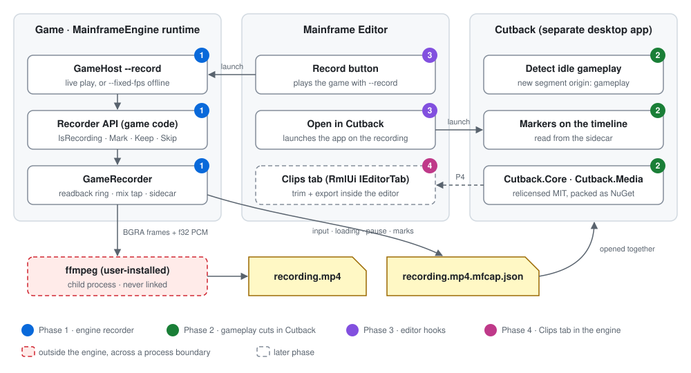
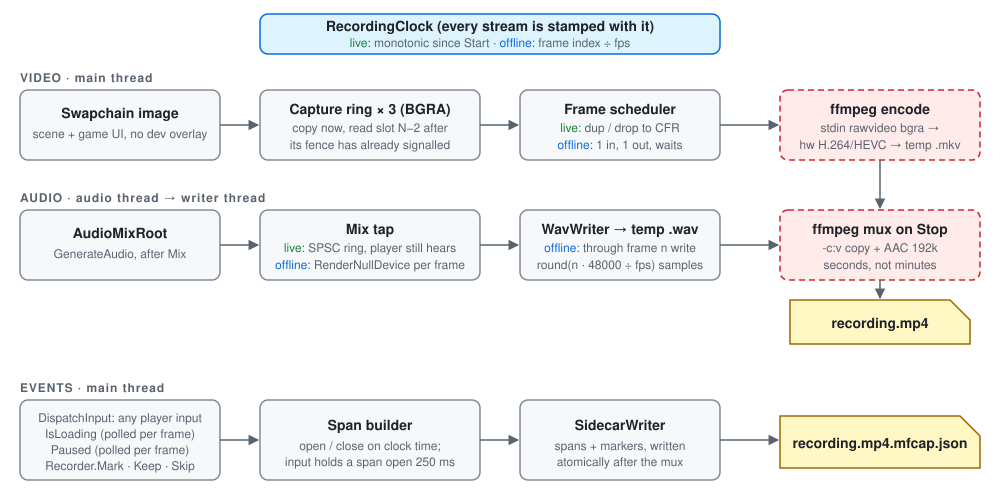
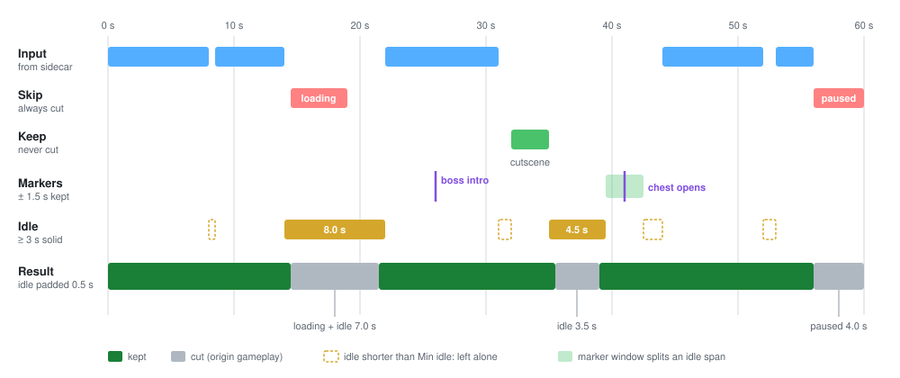
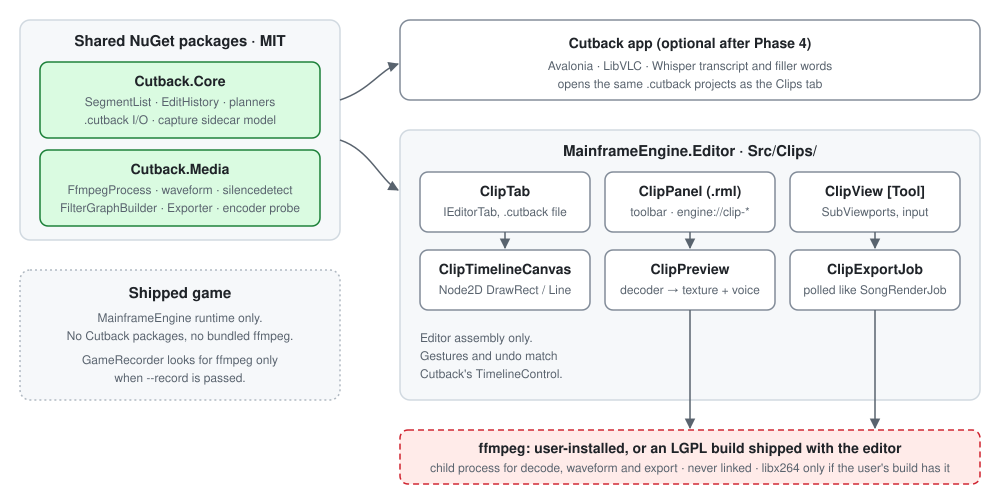

# Mainframe Engine integration: gameplay capture and trimming — design

Date: 2026-10-12. Status: written for review. Spans two repositories: this one (Cutback) and
`~/mainframe/mainframe-engine` (Mainframe Engine, MIT).

## Goal

Make promo footage for games built on Mainframe Engine with as little effort as making a Loom.
The engine records clean, frame-accurate gameplay. Cutback trims the dull parts automatically, using
what the engine knows about the recording (when the player was idle, when a loading screen was up,
what the game marked as worth keeping) instead of guessing from the audio. Then Cutback exports.

The end state is the same workflow inside the Mainframe Editor, as a "Clips" tab, with no separate app
and no GPL code in the engine.

## Non-goals

- **No trailer editor.** There are no titles, transitions, music beds, multi-track timelines or effects.
  Cutback's "not a NLE" rule applies to every phase, including the in-engine tab.
- **No input record/replay or re-rendering a run from a different camera.** That was considered and
  deferred. Offline mode covers scripted shots (flyovers, autowalk, QA scripts) because they are
  already deterministic.
- **No automatic HUD removal.** The engine captures what is on screen; games hide their own HUD (see 1.6).
- **No Whisper or transcript features in the engine.** They stay in the Cutback app.
- **No change to how shipped games play video.** The engine's G16 video-playback proposal is
  unaffected (see Licensing).

## Decisions taken

| Question | Decision |
|---|---|
| Workflow | The engine records clean gameplay and Cutback trims it. Recording and trimming stay separate steps with a file contract between them. |
| Approach | Phase it: the engine recorder first, then gameplay-aware cuts in Cutback, then editor hooks, then a Clips tab in the editor built on Cutback's core packages. Hosting Cutback's Avalonia UI in the editor and building in-engine from day one were both rejected. |
| End-state licence | MIT, like the engine. The editor ships Spine and Steam redistributables and cannot become a GPL work. |
| Recording modes | **Live** (a person plays: real time, the player hears audio) and **Offline** (`--fixed-fps`: deterministic, any resolution, exact sample counts). One pipeline, two clocks. |
| Encoder | The engine never links or bundles an encoder. It runs ffmpeg as a child process, prefers the platform hardware encoder, and writes a high-bitrate intermediate. |
| Audio transport | The live mix is tapped into a temp WAV, then muxed with the video when recording stops. A second named pipe per OS was rejected as fiddly for no gain. |
| What "dull" means | No player input for at least *Min idle*, plus loading screens and pause, minus anything the game marked Keep or near a marker. This is a new segment origin, `gameplay`. |
| Hand-off format | `<video>.mfcap.json` sidecar next to the video, owned by the engine, read by Cutback. |
| Sharing code with the engine | `Cutback.Core` and `Cutback.Media` are relicensed MIT (the repository has a single author) and published as NuGet packages. The editor references them; it does not fork them. |

## Overview



| Phase | Repository | Delivers | Useful on its own? |
|---|---|---|---|
| 1. Recorder | engine | `--record`, `SceneTree.Recorder`, the sidecar | Yes: clean 1080p60 live or 4K60 offline footage |
| 2. Gameplay cuts | Cutback | sidecar reader, *Detect idle gameplay*, markers on the timeline, MIT packages | Yes: one-click trim of a recording |
| 3. Editor hooks | engine | Record button, link protocol v4, *Open in Cutback* | Yes: record → trim in two clicks |
| 4. Clips tab | engine | trim and export inside the editor on Cutback.Core/Media | Cutback becomes optional |

Phases 1 and 2 can be built in parallel once the sidecar format (1.7) is agreed. Phase 3 needs 1.
Phase 4 needs 2 (the packages) and 3 (the recording-finished flow).

---

## Phase 1 — Recorder (engine, MIT)

New folder `MainframeEngine/Src/Recording/`. Engine-side docs: a subsystem doc
`docs/design/recording.md` (Purpose, Key types, Architecture/Threading, Performance, Known issues)
and **ADR 0190 — Gameplay recording via an ffmpeg child process** in `memory/decisions/`. The ADR
records the rejected options: linking libav*, bundling ffmpeg in games, and a named audio pipe.



### 1.1 Surface

**Command line** (`GameHostOptions`, documented in its `<summary>` table like the existing flags):

| Flag | Meaning |
|---|---|
| `--record <file.mp4>` | Record from the first frame until quit or `Recorder.Stop()`. Implies frame capture. |
| `--record-scale <n>` | Sets `EngineOptions.ContentScale` (e.g. a 1920×1080-point window at 2 is 3840×2160 px). Intended for offline mode. |
| `--ffmpeg <path>` | ffmpeg to use (the editor passes its preference). |

Mode is implied: **`--fixed-fps` present ⇒ offline, otherwise live.** `--max-frames` ends an
offline recording exactly.

**API** (`SceneTree.Recorder`, a `GameRecorder`; null under `--headless`):

```csharp
public sealed class GameRecorder
{
    public bool IsRecording { get; }
    public TimeSpan Elapsed { get; }                      // recording clock
    public event Action? Started;
    public event Action<RecordingResult>? Stopped;        // path, duration, dropped frames, error

    public void Start(RecordingOptions options);          // path, fps (default 60), ffmpeg path
    public void Stop();                                    // async finalise; Stopped fires when the mux is done

    public void Mark(string label);                        // point of interest
    public IDisposable Keep(string label);                 // never cut while open (cutscenes)
    public IDisposable Skip(string label);                 // always cut while open (menus)
}
```

`Mark`, `Keep` and `Skip` are cheap no-ops when not recording, so games can call them unconditionally.

### 1.2 Clock

`RecordingClock` gives every stream one timeline:

- **Live:** seconds of a monotonic `Stopwatch` since `Start`.
- **Offline:** `frameIndex / fps`, exactly. Game time already advances by `1/fps` per update under
  `FixedDeltaTime`, so the two agree.

Every sidecar time is on this clock, which is the output video's timeline.

### 1.3 Video

**Capture ring (VulkanRenderer).** A streaming variant of the existing capture:
`BeginCaptureStream(int slots = 3)` / `EndCaptureStream()`. `MaxFramesInFlight` is 2, so 3 host-visible
buffers are enough. The steps are:

1. `EndFrame` records the same barrier + `CmdCopyImageToBuffer` as `RecordCapture`, into slot
   `frame % 3`, and stores the frame's clock time with the slot.
2. When `BeginFrame` has waited on a frame's fence (which it already does to reuse that frame's
   resources), that slot's mapped memory is complete. The renderer hands the consumer a
   `ReadOnlySpan<byte>` over it plus the timestamp. **There is no extra fence wait and no swizzle.**
3. The consumer copies the span into a pooled buffer (`ArrayPool`, one copy, about 1 ms at 1080p) and
   queues it for the writer thread. The bounded queue holds 4 buffers.

The existing blocking `CaptureFrame` stays as it is for screenshots.

**Pixel format.** ffmpeg is told the swapchain's byte order (`-pix_fmt bgra` or `rgba` from
`_swapChainImageFormat`), so the CPU swizzle in `ReadBackCapture` is not needed for recording.

**Frame scheduler (pure, `FrameScheduler`).** It decides how many times each captured frame is
written, so the output is constant frame rate:

- **Live:** for a frame stamped `t`, `copies = floor(t · fps) − written + 1`. A value of 0 or less
  drops it. Slow frames duplicate; a 120 Hz display drops every other frame. The scheduler is asked
  *before* the copy is recorded, so frames that will be dropped are never copied.
- **Offline:** exactly one copy per frame. When the writer queue is full the main thread waits, which
  is harmless because game time does not move.
- **Live, writer queue full** (encoder slower than real time): drop the frame and count it. The next
  frame written gets the missing copies, so length and sync hold and only smoothness suffers. The
  count goes in the sidecar (`droppedFrames`) and in `RecordingResult`.

**Window size.** If the swapchain extent changes during a recording (resize, fullscreen toggle),
the recording stops cleanly with the reason "window size changed". Everything up to that point is
kept.

### 1.4 Audio

**Live: mix tap.** In `AudioMixRoot.GenerateAudio`, after `graph.Mix(buffer, channels); AfterMix(graph);`,
when a tap is attached, copy `buffer` into an `SpscRing<float>` (2 s capacity), along with the clock
time of the block. This is the device output (the chain after the root is unity gain), so the player
still hears everything. The callback stays lock-free and allocation-free (audio.md rules).
`AudioServer.BeginCapture()` / `EndCapture()` attach and detach the tap.

A writer thread drains the ring into a temp WAV with the existing `WavWriter`:

- Samples stamped before `t0` are dropped, so audio starts on the same instant as frame 0 with
  sample accuracy.
- Ring overflow writes silence for the lost span, so the length still matches. It is counted and
  logged.

**Offline: null device.** The engine starts with `AudioDeviceMode.NullManual`. After each update the
recorder calls `AudioServer.RenderNullDevice(n, span)`, where
`n = round((f+1) · 48000 / fps) − round(f · 48000 / fps)` for frame `f`. That keeps the total exact
for any fps (`SampleScheduler`, pure). The player hears nothing in this mode, by design.

### 1.5 Encoding

**Locating ffmpeg (`FfmpegResolver`):** `--ffmpeg` → `MAINFRAME_FFMPEG` → `PATH` → per-OS locations
(`/opt/homebrew/bin`, `/usr/local/bin`, `C:\ffmpeg\bin`, the winget links folder).

When ffmpeg is missing, `Start` fails with a readable message naming `brew install ffmpeg` /
`winget install Gyan.FFmpeg` / `sudo apt install ffmpeg`. It does not crash and does not silently
no-op. This mirrors Cutback's `FfmpegLocator`. It is duplicated rather than shared, because Phase 1
must not wait for the Phase 2 packages.

**Choosing an encoder (`EncoderSelector`, pure over the parsed output of `ffmpeg -hide_banner -encoders`).**
The first candidate that passes a 0.1 s probe encode (`-f lavfi -i color=s=64x64 … -f null -`, result
cached for the process) wins:

| OS | Order |
|---|---|
| macOS | `h264_videotoolbox` |
| Windows | `h264_nvenc`, `h264_qsv`, `h264_amf`, `h264_mf` |
| Linux | `h264_nvenc` |
| all, fallback | `libx264 -preset ultrafast -crf 14`, `libopenh264` |

Using `libx264` from the user's own ffmpeg build does not affect the engine's licence; the engine only
starts a process.

**Rate and GOP.** Bitrate is `width · height · fps · 0.25` bits/s (about 31 Mbit/s at 1080p60 and
124 Mbit/s at 4K60). That is an intermediate, not a delivery file. The GOP is one second
(`-g <fps>`), so Cutback's Fast export never moves a cut more than a second.

**Files.** While recording:
- video goes to `<out>.partial/video.mkv` (MKV, so a crash leaves a playable file);
- audio goes to `<out>.partial/audio.wav`.

`Stop` runs `ffmpeg -i video.mkv -i audio.wav -c:v copy -c:a aac -b:a 192k -movflags +faststart <out>`,
writes the sidecar, then deletes `.partial/`. On failure `.partial/` is kept and `RecordingResult.Error`
says where it is.

Progress and health come from `-progress pipe:1`, parsed the same way as in Cutback. If the encoder
process exits early, the recording stops with its stderr tail as the error.

### 1.6 Events

| Source | Hook | Becomes |
|---|---|---|
| Player input | `SceneTree.DispatchInput`, before the UI can consume the event | `input` spans |
| Loading | `SceneTree.IsLoading`, polled once per frame | `loading` spans |
| Pause | `SceneTree.Paused`, polled once per frame (it has no change event) | `paused` spans |
| Game | `Recorder.Mark/Keep/Skip` | `markers`, `keep`, `skip` |

Which events count as input:
- a key or button down;
- a mouse button;
- mouse motion over 2 px;
- a gamepad axis whose magnitude exceeds 0.25 (the recorder's own threshold, independent of
  `InputAction.Deadzone`).

Each event holds the `input` span open for 250 ms, and a held key or button keeps it open. Spans are
built by `SpanBuilder` (pure).

**HUD.** The recorder forces the dev overlay off while recording. Games that want a clean feed check
`Recorder.IsRecording` (or subscribe to `Started`/`Stopped`) and hide their HUD themselves. Forest
gets a `--no-hud` game flag as the worked example.

### 1.7 Sidecar format, version 1

`<video file name>.mfcap.json`, next to the video (`forest-20261012-143005.mp4.mfcap.json`). It is
written atomically (temp file and rename) after the mux succeeds. All times are seconds on the output
video's timeline.

```jsonc
{
  "format": "mainframe-capture",
  "version": 1,
  "video": "forest-20261012-143005.mp4",   // file name, relative to the sidecar
  "engineVersion": "0.42.0",
  "game": "Forest",
  "scene": "res://Scenes/Forest.scn",
  "mode": "live",                          // "live" | "offline"
  "frameRate": 60,
  "width": 1920,
  "height": 1080,
  "durationSeconds": 60.0,
  "droppedFrames": 0,
  "input":   [ { "start": 0.0,  "end": 8.0 } ],
  "loading": [ { "start": 14.5, "end": 19.0 } ],
  "paused":  [ { "start": 56.0, "end": 60.0 } ],
  "keep":    [ { "start": 32.0, "end": 35.0, "label": "cutscene" } ],
  "skip":    [ ],
  "markers": [ { "time": 26.0, "label": "boss intro" } ]
}
```

Rules:
- Every span list is sorted and non-overlapping within itself. Lists may overlap each other.
- Unknown fields are ignored. A higher `version` is a new contract, and readers refuse it with a
  clear message.
- The engine owns the format. The canonical example lives in the engine at
  `Tests/MainframeEngine.Tests/Recording/Fixtures/sample.mfcap.json`, and an identical copy lives in
  Cutback's tests. Both test suites parse it, so drift fails CI on both sides.

### 1.8 Testing (engine)

All tests are pure; ffmpeg is never run:
- `FrameScheduler` (dup/drop sequences at 30, 60, 120 Hz input; writer-full drops);
- `SampleScheduler` (totals exact over 10 000 frames at 24/25/30/50/60/144 fps);
- `SpanBuilder` (hold, 250 ms tail, overlap);
- `EncoderSelector` over captured `-encoders` text from each OS;
- `GameHostOptions` parsing of the new flags;
- the ffmpeg argument builders, asserted as strings;
- the sidecar round-trip against the fixture;
- the `GameRecorder` state machine with a fake sink (Start/Stop, Stop during Start, encoder death).

The Forest screenshot harness (`build/forest-screenshots.sh`) gains an offline recording smoke script
that runs locally, not in CI.

---

## Phase 2 — Gameplay cuts in Cutback

### 2.1 Licensing and packaging

- `src/Cutback.Core` and `src/Cutback.Media` each get an MIT `LICENSE`, `PackageLicenseExpression=MIT`,
  `IsPackable=true`, and package ids `Cutback.Core` / `Cutback.Media`.
- The release workflow packs and pushes both packages on tagged releases.
- `Cutback.Analysis` and `Cutback.App` are unchanged. The app's own licence is an open question
  (see the end); this spec does not need it to change.
- `Cutback.Media` keeps its FFMpegCore (MIT) dependency.
- CLAUDE.md's Licensing section and `THIRD-PARTY-NOTICES.md` are updated.

### 2.2 Core

**`Capture/` (new folder).**
- `CaptureSidecar` holds the records `CaptureSpan(Start, End, Label?)` and `CaptureMarker(Time, Label)`.
- `CaptureSidecarSerializer` uses the System.Text.Json source-generated context. It throws
  `CaptureSidecarFormatException` on a wrong `format`, a newer `version`, or invalid spans.
- `CaptureSidecar.PathFor(videoPath)` returns `videoPath + ".mfcap.json"`.

**`SegmentOrigin.Gameplay`** (`"gameplay"`). Project schema bumps to **version 3**; the 2→3 migration
is a no-op, registered exactly like 1→2.

**`GameplaySettings`** record: `MinIdleMs` (default 3000), `PaddingMs` (500), `MinKeepMs` (1000),
`MarkerWindowMs` (1500).

**`GameplayCutPlanner.Plan(sidecar, settings, duration, segments)`**, pure. Worked example below:



1. *Idle* = the complement of `input` within `[0, duration]`. **Live recordings only**; an offline recording has no input, so only steps 4–6 apply.
2. Subtract `keep` spans, and each marker's `±MarkerWindowMs` window, from idle.
3. Drop idle pieces shorter than `MinIdleMs`, then shrink the rest by `PaddingMs` at each end. The
   padding is generous because it gives a lead-in, not because consonants need protecting.
4. Skip ranges = `loading ∪ paused ∪ skip`, **unpadded**: the engine knows those edges exactly.
   Subtract `keep` from them (Keep beats Skip). Markers do not override Skip.
5. Union of 3 and 4, then bridge kept gaps shorter than `MinKeepMs` (the same rule as
   `SilenceCutPlanner`; the merge loop moves into a shared internal `CutMerger` used by both).
6. Subtract `Manual` segments from every cut (clip, do not drop: gameplay cuts are long). Drop pieces shorter than `SegmentList.MinSegmentLength`.

Reasons are `idle 3.5s`, `loading 4.5s`, `paused 4.0s`, `skip: <label>`, and joined with ` + ` when
a merged cut has several (`loading + idle 7.0s`). An idle stretch wholly inside a loading, pause or skip
span is not named in the reason.

**`SegmentList`.** `ApplyFillerCuts` becomes a wrapper around a new general
`ReplaceOriginCuts(SegmentOrigin origin, IEnumerable<PlannedCut> cuts)`, and `DissolveFillerCore`
becomes `DissolveOriginCore(origin)`. The public signature of `ApplyFillerCuts` and its tests are
unchanged. `ReplaceAutoSegments` already preserves every non-`auto` segment, so:
- silence re-detection keeps gameplay cuts;
- gameplay re-detection keeps silence and filler cuts;
- both keep manual edits.

The invariant is asserted as in every other mutating operation.

### 2.3 App

- **Settings.** `AppSettings.Gameplay` (`set`, not `init`). `AppSettingsStore.Sanitize` clamps the
  values: MinIdle 500–60 000, Padding 0–2000, MinKeep 0–10 000, MarkerWindow 0–10 000. Preferences
  gains a **Gameplay detection** section under Silence detection.
- **Opening.**
  - When a video opens, the view model looks for `CaptureSidecar.PathFor(path)`. If found, it loads it
    into `Capture` and the status line reads "Mainframe recording · 3 markers".
  - A malformed or newer sidecar shows a warning banner. The video still opens.
  - Projects re-read the sidecar from next to the source on open. Nothing about the sidecar is stored
    in the `.cutback` file.
- **Command.** `DetectIdleGameplayCommand` (CanExecute: has a project, `Capture` is not null, not busy):
  - it is one `Edit(s => s.ReplaceOriginCuts(Gameplay, cuts))`, so one undo step;
  - status reads "Removed 6 idle stretches, 1:42 removed.";
  - toolbar: an icon button using Lucide `gamepad-2` (added to `Icons.axaml` and the notices), visible
    only when `HasCapture`;
  - Edit menu: **Detect Idle Gameplay**.
- **Timeline markers.**
  - `TimelineControl` gets a `Markers` property (`IReadOnlyList<CaptureMarker>?`).
  - Markers draw as small triangles in the ruler with a `TimelineMarker` colour resource from
    `Theme.axaml`.
  - The label appears in the existing hover readout. Scrubbing the ruler already seeks to them.
- **Command-line open** already exists (`App.axaml.cs` opens the first existing path in `desktop.Args`), and Phase 3 relies on it unchanged.

### 2.4 Docs (Cutback)

CLAUDE.md:
- the origin list (`auto | manual | claude | filler | gameplay`) and the who-locks-what paragraph;
- schema version 3;
- a short "Mainframe recordings" section pointing at the sidecar contract;
- the Licensing split;
- the layout tree (`Capture/`).

README: one paragraph and a screenshot.

### 2.5 Testing (Cutback)

- `CaptureSidecarSerializer` against the shared fixture, plus malformed and newer-version cases.
- `GameplayCutPlanner`: the diagram's minute as one test; Keep beats Skip; marker windows; the
  `MinIdle` boundary; manual segments untouched; empty input means everything is idle.
- `ReplaceOriginCuts` with the partition invariant, and existing filler tests unchanged.
- The 2→3 migration.
- Settings sanitising.

---

## Phase 3 — Editor hooks (engine)

- **Run menu and toolbar.**
  - Run menu: **Play and Record** (`play.record`, Shift+F5 if free; F9 is the UI debugger).
  - Toolbar: a `#record` button in `toolbar.rml`'s play group.
  - When the game is not running, the button plays the main scene with
    `--record {user data}/{game}/recordings/{scene}-{yyyyMMdd-HHmmss}.mp4` added to `PlayRequest`'s
    extra args. While the game is running, it toggles recording over the link. It is red while
    recording. Enabled state lives in `Panels.cs` beside the play buttons.
- **Editor link, protocol version 4.**
  - New commands `EditorCommandKind.StartRecording = 7` (Argument = path) and `StopRecording = 8`.
    `TryDecode`'s range check is widened and `GameSession.Apply` handles both.
  - New game→editor message `Recording = 8`, carrying state (`Started | Stopped | Failed`), path,
    elapsed seconds, dropped frames and error text. It is queued like `SendTree` and drained in
    `PlayService.DrainLink`.
  - **`Version` = 4.**
- **Status.** `#play-status` shows `● REC 01:23` while recording.
- **When a recording finishes**, a notification offers **Open in Cutback** and **Show in Folder**.
  Phase 4 adds **Open in Clips Tab**. A `Failed` state shows the error and the `.partial` path.
- **`CutbackLocator`** (editor) resolves in this order:
  1. the editor preference `cutback.path`;
  2. `PATH` (`cutback`, `Cutback`);
  3. `/Applications/Cutback.app/Contents/MacOS/Cutback`, `%LOCALAPPDATA%\Programs\Cutback\Cutback.exe`,
     `~/.local/bin/cutback`.

  It launches with the recording path as the only argument. If nothing is found, the message links
  Cutback's releases page and the preference.
- **Testing:**
  - protocol round-trip for the new command and message, plus the version check;
  - recording path naming;
  - `CutbackLocator` order over a fake file system;
  - a QA script (`--qa-script`) that clicks Record, waits, stops, and asserts the notification.

---

## Phase 4 — Clips tab in the editor (engine)



### 4.1 Dependencies

- `MainframeEngine.Editor` references `Cutback.Core` and `Cutback.Media`, with versions in
  `Directory.Packages.props`.
- The runtime (`MainframeEngine`) never does, so shipped games never contain them.
- `THIRD_PARTY_NOTICES.md` gains Cutback.Core, Cutback.Media and FFMpegCore (all MIT).

Before this phase, `Cutback.Media` gains `EncoderSelector`, the same probe idea as 1.5 but for
delivery quality:
- `Exporter`'s Precise mode uses `libx264 -crf 20` when present;
- otherwise the platform hardware encoder at a quality target;
- otherwise `libopenh264`.

The Cutback app benefits too, because it currently fails on an ffmpeg built without x264.

### 4.2 Structure

`MainframeEngine.Editor/Src/Clips/`, modelled on `Src/Music/`:

| Type | Role |
|---|---|
| `ClipTab : IEditorTab` | A `.cutback` project (the same file format as the Cutback app, so a project round-trips between them). `IsDirty` comes from its `EditHistory`. |
| `ClipPanel` + `Content/Editor/clips.rml/.rcss` | Toolbar (Detect idle gameplay, Detect silence, Undo/Redo, Export), preview ``, timeline ``. |
| `ClipView` (`[Tool]` node) | Owns the `SubViewport`s, registers the textures with `UiServer`, routes input to the controller. |
| `ClipTimelineCanvas` (`Node2D`) | Port of `TimelineControl`'s draw pass (`SKCanvas` calls become `DrawRect`/`DrawLine`): segments, waveform, markers, playhead, ruler. |
| `ClipCanvasController` | Port of the gestures: click to toggle, right-click → Delete, boundary drag with quiet-sample snap, body drag to draw a section, Shift+drag to pan, wheel to zoom, ruler scrub, Delete/Backspace. |
| `ClipPreview` | Video and audio preview (4.3). |
| `ClipExportJob` | Wraps `Exporter` like `SongRenderJob`: `Task.Run`, `IProgress<double>` into a volatile field, polled each frame, cancellable. |

Session wiring follows `SongTab`:
- `is ClipTab` branches in `EditorSession` and `EditorCommands.Run`, so Undo/Redo/Save reach the
  tab's `EditHistory` and project.
- File → Open accepts `.cutback` files and videos.
- The Phase 3 notification gains **Open in Clips Tab**.

### 4.3 Preview

`ClipPreview` decodes with ffmpeg child processes, through `FfmpegProcess` from Cutback.Media:

- video as `rawvideo rgba` scaled to at most 960 px wide, into a texture registered as
  `engine://clip-preview`;
- audio as `f32le 48 kHz` into an `AudioServer` voice. The voice's consumed sample count is the
  clock, the same idea as the G16 proposal.

**Preview is gapless.** One decoder pair runs per kept segment. The next segment's pair is started a
second before the current one ends, and playback switches at the boundary. This is better than the
Cutback app's VLC seek-hitch, and it is possible here because the editor owns decoding.

**Scrubbing** decodes one frame (`-ss t -frames:v 1`). The waveform comes from Cutback.Media's
`WaveformExtractor`.

This path is editor-only. When G16 lands it does not replace it, because G16 targets AV1/WebM for
games while recordings are H.264.

### 4.4 Not ported

- Transcript, Whisper and filler words stay in the Cutback app.
- LibVLC and Avalonia are not needed.
- The Cutback app keeps working on the same projects for anyone who wants those features.

### 4.5 Testing

- Engine tests cover the `ClipTimelineCanvas` hit-testing and coordinate maths (pure helpers
  extracted, as with the song canvases), the decoder-pair schedule, and the `.cutback` round-trip
  between the tab and the packages.
- The partition and undo logic is already covered by Cutback.Core's tests.
- A QA script opens a fixture recording, runs Detect idle gameplay, and captures the tab for a golden
  image.

---

## Licensing summary

| Component | Licence | Why it is fine |
|---|---|---|
| Engine runtime + recorder | MIT | Starts ffmpeg as a separate program, never links it |
| Mainframe Editor + Clips tab | MIT | Links only MIT packages; Spine and Steam are unaffected |
| Cutback.Core, Cutback.Media | MIT (relicensed by their sole author) | Pure .NET + FFMpegCore (MIT) |
| Cutback app | GPL-3.0 today (open question below) | Separate program; nothing in the engine links it |
| ffmpeg | the user's build, or an LGPL build shipped with the editor | Process boundary. If the editor ever bundles ffmpeg, it must be an LGPL build without x264; `EncoderSelector` already copes. |
| Shipped games | unchanged | Contain neither the packages nor ffmpeg |

## Acceptance

1. **Recorder.**
   - Forest, live, 2 minutes at 1080p60 on an Apple-silicon Mac: at most 0.5% duplicated frames, and
     A/V offset within one frame at both start and end (a test scene beeps and flashes white on
     `Mark`).
   - Offline: `--fixed-fps 60 --record-scale 2 --max-frames 3600 ++ --camera flyover` produces exactly
     3600 frames at 3840×2160 and 60.000 s of audio.
2. **Gameplay cuts.**
   - Opening the Forest recording in Cutback and running Detect idle gameplay removes the loading
     screen and idle stretches.
   - Detect silence afterwards keeps them, and manual toggles survive both re-runs.
   - Undo reverts each run in one step, and export works.
3. **Editor hooks.** Record from the editor, stop, **Open in Cutback**, and the recording opens with
   its markers.
4. **Clips tab.**
   - The same flow works entirely inside the editor on a machine with no Cutback app installed.
   - A project saved in the tab opens in the Cutback app unchanged, and the other way round.

## Known limits accepted

- Live capture records exactly what is on screen, at window resolution. Clean HUD-free and 4K footage
  is the game's choice (`IsRecording`) or offline mode.
- Live audio runs on the device clock and video on the monotonic clock. Drift is far below a frame
  over minutes; it is logged at Stop, not corrected.
- Mouse motion counts as input, so a player looking around is never "idle". That is intended.
- An encoder slower than real time costs smoothness (duplicated frames), never sync or length.
- Every phase requires ffmpeg to be installed, with the same clear message everywhere when it is not.

## Open questions

1. **Cutback app licence.** Cutback runs a user-installed ffmpeg and bundles nothing GPL, so the app
   could also be MIT. Keep GPL-3.0, or relicense everything?
2. **Package feed.** nuget.org (required if third parties build the editor from source) or GitHub
   Packages?
3. **Recording in shipped games.** `--record` works in any build. Should a project setting be able to
   disable it in release builds?
4. **Shortcut.** Is Shift+F5 free for Play and Record? (F9 is taken by the UI debugger.)
